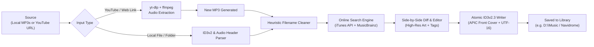

<div align="center">

# 🎵 MP3 Metadata Corrector & YouTube MP3 Downloader

**A modern Windows 11 desktop application for downloading, searching, correcting MP3 metadata, and embedding high-resolution album artwork.**

[](https://github.com/KoolBhushan/Mp3MetadataCorrector/actions/workflows/build-installer.yml)
[-blue.svg?logo=windows)](https://microsoft.com)
[](https://github.com/microsoft/microsoft-ui-xaml)
[](https://dotnet.microsoft.com/)
[](LICENSE)

<br />

[Features](#-features) • [Workflow](#-workflow-architecture) • [Installation](#-installation) • [Getting Started](#-getting-started) • [Building from Source](#-building-from-source) • [Architecture](#-project-architecture)

</div>

---

## 📖 Overview

**MP3 Metadata Corrector** is a native **WinUI 3 (Windows App SDK)** desktop application built with **.NET 10**. It solves the problem of messy, untagged, or incorrectly labeled MP3 files by combining:

1. **Smart Dirty Filename Sanitization**: Intelligently cleans noisy file names (removing track numbers, quality stamps, `[Official Video]`, `(Lyrics)`, websites, and YouTube artifacts).
2. **Multi-Source Online Search**: Queries both the **iTunes Search API** and **MusicBrainz** to match recordings and fetch official credits and ultra-crisp **1000×1000** album artwork.
3. **Integrated `yt-dlg` Downloader**: Built-in YouTube / SoundCloud downloader powered by `yt-dlp` and `ffmpeg` that extracts high-bitrate MP3s and immediately stages them for metadata tagging.
4. **Non-Destructive Tag Engine**: Reads and writes standard **ID3v2.3** (with universal UTF-16 BOM encoding) and **ID3v1** tags, embedding front cover art into standard `APIC` frames without re-encoding or corrupting the MPEG audio stream.
5. **Seamless Music Server Integration**: Perfect companion for local libraries and self-hosted streaming servers like **Navidrome**, **Plex**, **Jellyfin**, and **Subsonic**.

---

## ✨ Features

### 🔍 Smart Metadata Search & Matching
* **Multi-Provider Search**: Queries **iTunes** (instant, commercial-grade tags, 1000x1000 art) and **MusicBrainz** (open music encyclopedia).
* **Heuristic Query Parser**: Automatically detects `Artist - Title` patterns from messy filenames:
  * `01 - Sample Artist - Song Title (Official Video) [320kbps].mp3` ➔ Artist: `Sample Artist`, Title: `Song Title`
  * `04. Musician Name - Track Name (Lyrics).mp3` ➔ Artist: `Musician Name`, Title: `Track Name`
* **Custom Search Query**: Search for alternative versions, live performances, or remixes with a manual query box.

### 🖼️ Album Art Embedder
* **High-Resolution Front Cover**: Automatically downloads 1000×1000 artwork and embeds it directly into the MP3's `APIC` ID3v2 frame.
* **Custom Image Picker**: Use your own `.jpg` or `.png` images.
* **Remove Artwork**: Strip unwanted or corrupted embedded pictures with one click.

### 📥 Integrated YouTube / Media Downloader (`yt-dlg`)
* **Download as MP3**: Paste any YouTube, SoundCloud, or media URL to extract the highest-quality audio (up to 320 kbps).
* **Built-in Tooling**: Automatically detects or installs `yt-dlp.exe` and `ffmpeg.exe`.
* **Automatic Tagging Pipeline**: Newly downloaded MP3s automatically populate into the editor queue and immediately trigger an online metadata search.

### ⚖️ Side-by-Side Comparison & Manual Tweaking
* **Original File Card**: Shows existing tags, embedded cover preview, bitrate (kbps), sample rate (kHz), channels, file size, and duration.
* **New Corrected Metadata Card**: Review every candidate field (Title, Artist, Album, Album Artist, Year, Genre, Track Number / Total, Disc Number, Comment) before saving.
* **Automatic File Renaming**: Option to rename files cleanly to `Artist - Title.mp3` upon saving.

### 💻 Windows 11 Fluent Interface
* Designed with native WinUI 3 controls, responsive layouts, progress indicators, and system theme integration.
* **Drag & Drop**: Drag `.mp3` files or entire folders straight into the application.
* **Batch Support**: Load entire album folders and process files in queue.

---

## 🔄 Workflow Architecture



---

## 📦 Installation

### Option 1: Standalone Setup Installer (Recommended)
Download the latest `Mp3MetadataCorrector_Setup.exe` from the [**Releases**](https://github.com/KoolBhushan/Mp3MetadataCorrector/releases) or the latest [**GitHub Actions Artifacts**](https://github.com/KoolBhushan/Mp3MetadataCorrector/actions):
1. Run `Mp3MetadataCorrector_Setup.exe`.
2. Select your installation directory (defaults to `%LocalAppData%\Programs\Mp3MetadataCorrector`).
3. Check the desired options (Desktop Shortcut, Start Menu Shortcut).
4. Click **Install**.

*An uninstaller is included and registered under Windows **Installed Apps / Settings**.*

### Option 2: Scripted / Silent Installation (PowerShell)
You can run the automated installer script located in `Output_Installer`:
```powershell
& ".\Output_Installer\Install.ps1"
```

---

## 🚀 Getting Started

1. **Launch the App**: Open **MP3 Metadata Corrector** from your Start Menu or Desktop shortcut.
2. **Add Files**:
   * Click **Open File** to select `.mp3` files.
   * Click **Open Folder** to load an entire album or music library folder.
   * Or drag-and-drop `.mp3` files directly onto the window.
3. **Or Download from YouTube**:
   * Click **Download MP3** in the top bar.
   * Paste the video URL, verify the save folder (e.g. `D:\Music`), and click **Download as MP3**.
4. **Match Metadata**:
   * Select a track from the queue on the left.
   * Review the search results list.
   * Click **Apply Match** on the matching track to populate tags and high-res cover art.
5. **Save**:
   * Edit any fields if desired.
   * Click **Save & Update MP3 Tags**.

---

## 🛠️ Building from Source

### Prerequisites
* **Windows 10** (build 19041+) or **Windows 11**
* [.NET 10 SDK](https://dotnet.microsoft.com/download/dotnet/10.0)
* Windows App SDK / Visual Studio 2022 (v17.8+) or Visual Studio 18 Enterprise with Windows App SDK workload.

### Clone and Build
```powershell
# Clone repository
git clone https://github.com/KoolBhushan/Mp3MetadataCorrector.git
cd Mp3MetadataCorrector

# Build Debug
dotnet build Mp3MetadataCorrector/Mp3MetadataCorrector.csproj

# Run tests
dotnet run --project Mp3MetadataCorrector.Tests/Mp3MetadataCorrector.Tests.csproj

# Run App
dotnet run --project Mp3MetadataCorrector/Mp3MetadataCorrector.csproj -c Release
```

### Build the Installer
```powershell
# 1. Publish application
dotnet publish Mp3MetadataCorrector/Mp3MetadataCorrector.csproj -c Release -r win-x64 --self-contained false -o publish

# 2. Package payload archive
Add-Type -AssemblyName System.IO.Compression.FileSystem
[System.IO.Compression.ZipFile]::CreateFromDirectory("publish", "installer/app_payload.zip")

# 3. Compile standalone setup wizard
dotnet publish installer/Mp3MetadataCorrector.Installer.csproj -c Release -o Output_Installer
```

---

## 📂 Project Architecture

```
Mp3MetadataCorrector/
├── .github/workflows/
│   └── build-installer.yml            # CI/CD: Automated build & installer packaging on push/PR
├── Mp3MetadataCorrector/              # Main WinUI 3 Desktop Application
│   ├── App.xaml / App.xaml.cs         # WinUI application lifecycle & resources
│   ├── MainWindow.xaml / .xaml.cs     # Windows 11 Fluent UI, file picker & drag-and-drop
│   ├── Helpers/
│   │   ├── ImageHelper.cs             # In-memory byte array to BitmapImage conversion
│   │   └── VisibilityHelper.cs        # Type-safe x:Bind conditional visibility helpers
│   ├── Models/
│   │   ├── TrackMetadata.cs           # MP3 metadata & audio properties (bitrate, duration)
│   │   ├── SearchResult.cs            # Normalized search results from iTunes & MusicBrainz
│   │   └── DownloadProgressReport.cs  # yt-dlp real-time progress model
│   ├── Services/
│   │   ├── FileNameParser.cs          # Heuristic cleaner for noisy audio filenames
│   │   ├── MetadataSearchService.cs   # iTunes & MusicBrainz API search and image downloader
│   │   ├── Mp3TagService.cs           # Custom zero-dependency ID3v2.3/ID3v1 reader & writer
│   │   └── YtDownloaderService.cs     # yt-dlp & ffmpeg process manager
│   ├── ViewModels/
│   │   └── MainViewModel.cs           # MVVM ViewModel with reactive properties & commands
│   └── app.manifest                   # DPI awareness & Windows compatibility manifest
├── Mp3MetadataCorrector.Tests/        # Automated Verification Suite
│   └── Program.cs                     # Tests filename parsing & round-trip ID3/APIC writing
├── installer/                         # Standalone Windows Setup Installer Project
│   ├── Program.cs                     # WinForms Setup GUI Wizard & Uninstaller logic
│   └── setup.iss                      # Inno Setup Script
└── Output_Installer/                  # Generated release installers
    └── Install.ps1                    # Scripted PowerShell installer
```

---

## 🤝 Contributing

Contributions, feature requests, and bug reports are welcome!
1. Fork the Project.
2. Create your Feature Branch (`git checkout -b feature/AmazingFeature`).
3. Commit your Changes (`git commit -m 'Add some AmazingFeature'`).
4. Push to the Branch (`git push origin feature/AmazingFeature`).
5. Open a Pull Request.

---

## 📄 License

This project is licensed under the MIT License - see the [LICENSE](LICENSE) file for details.
